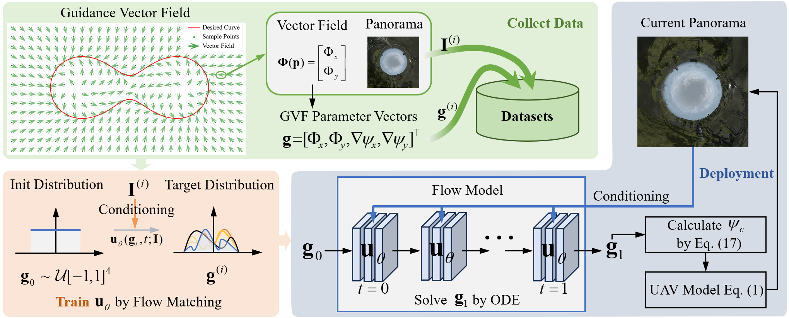
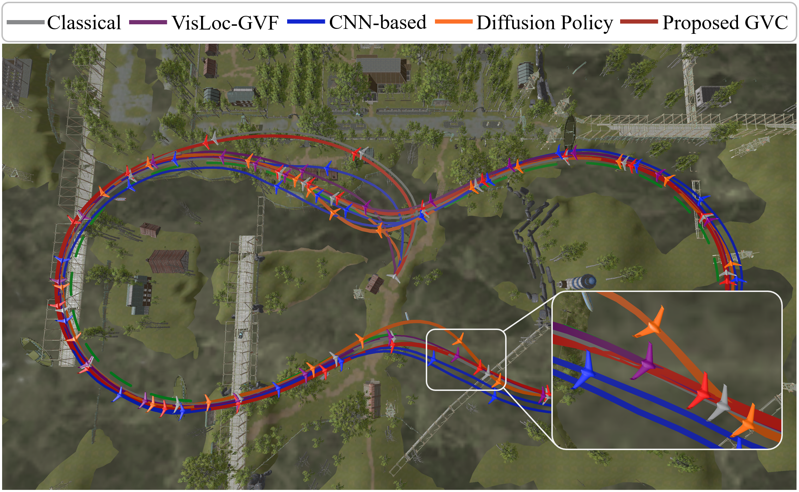
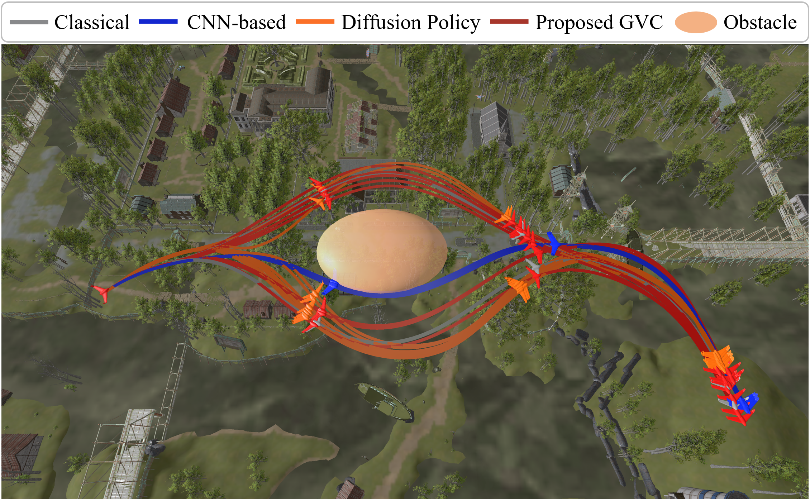
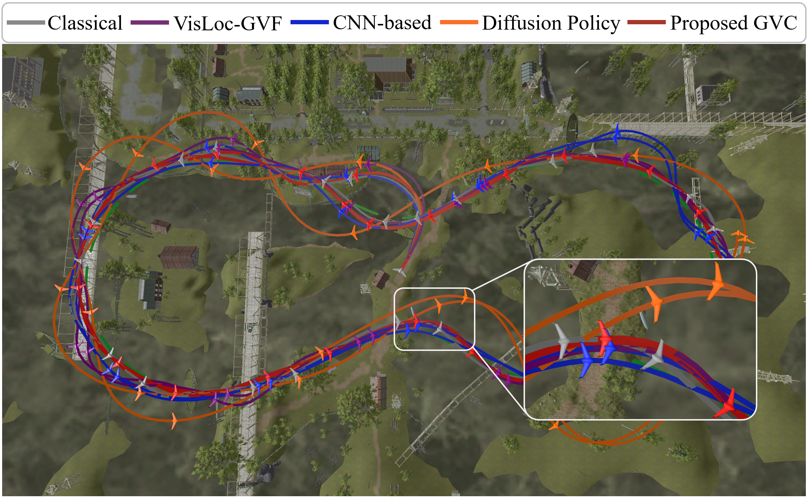

# Generative Visual Control

Official repository for the paper **"Generative Visual Control: Flow Matching for Vector Field Guidance of Fixed-wing UAVs from Visual Inputs"**.

> **Code release notice**
>
> The source code, training scripts, evaluation tools, trained-model interfaces, and experiment documentation are available in this repository. The real-time benchmark package includes separate PC PyTorch, Orin NX PyTorch, and Orin NX TensorRT entry points.

## Overview

Generative Visual Control (GVC) learns to generate guidance vector field parameters for fixed-wing UAVs directly from visual inputs. The method uses flow matching to model the conditional distribution of vector field parameters, enabling visual-input-driven guidance that can be deployed with the UAV dynamics model.

  

## Visual Results

The following figures compare the proposed GVC method with classical and learning-based baselines on representative fixed-wing UAV guidance tasks. The desired curve is shown in green, while the proposed GVC trajectory is shown in red.

### Basic Path Following

  

### Multimodal Obstacle Avoidance

  

### High-Fidelity Fixed-Wing Simulation with JSBSim

  

## Repository Status

The repository contains the reproducible implementation and visualization code for the experiments in the paper:

- Core GVC, CNN, Diffusion Policy, and classical vector-field controllers.
- Experiment scripts for basic path following, multimodal obstacle avoidance, and JSBSim fixed-wing simulation.
- Training, offline evaluation, closed-loop evaluation, and plotting utilities.
- Standalone benchmark code for PC PyTorch, Orin NX PyTorch, and Orin NX TensorRT.
- Additional VisLoc-GVF, visual robustness tests, and GVF consistency diagnostics.

Unity communication uses the separately maintained `AFPV_Kit` package, which
is not included in this repository.

## Repository Structure

| Files | Purpose |
| --- | --- |
| `exp1_basic_path_following.py` | Planar path following. |
| `exp2_multimodal_obstacle_avoidance.py` | Multimodal guidance around elliptical obstacles. |
| `exp3_high_fidelity_fixed_wing_jsbsim.py` | JSBSim fixed-wing simulation. |
| [`exp4_realtime_benchmark/`](exp4_realtime_benchmark/README.md) | PC PyTorch, Orin NX PyTorch, and Orin NX TensorRT benchmarks. |
| `src/` | Controllers, models, training, and evaluation. |
| `src/baseline/position_localization.py` | Visual position regression. |
| `plot_data_cassini.py`, `plot_data_cassini_jsbsim.py`, `plot_quartic_obstacle_results.py` | Trajectory plots and tracking-error statistics. |
| [`supplementary/`](supplementary/README.md) | Visual robustness and GVF diagnostics. |

## Experimental Parameters

The JSBSim experiment requires the Skywalker X8 model installed in JSBSim
and uses a PID autopilot.
Each run saves its settings in `run_config.json`.

| Parameters | Location |
| --- | --- |
| Initial conditions and planar dynamics | `exp1_basic_path_following.py` |
| Obstacle geometry and multimodal guidance | `exp2_multimodal_obstacle_avoidance.py`, `src/path_following/create_path_quartic_obstacle.py` |
| JSBSim commands and guidance | `exp3_high_fidelity_fixed_wing_jsbsim.py` |
| Autopilot PID gains | [`src/jsbsim_config.py`](src/jsbsim_config.py) |
| Visual robustness | `supplementary/visual_robustness/common.py` |
| GVF diagnostics | `supplementary/gvf_diagnostics/settings.py` |

See [Supplementary Experiments](supplementary/README.md) for setup and commands.

## License

This project is released under the license provided in [LICENSE](LICENSE).
