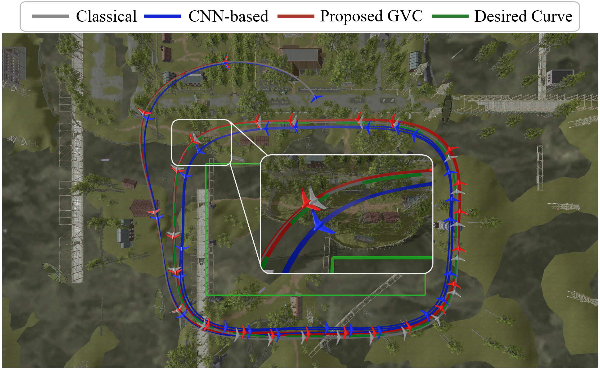

# Generative Visual Control

Official repository for the paper **"Generative Visual Control: Flow Matching for Vector Field Guidance of Fixed-wing UAVs from Visual Inputs"**.

> **Code release notice**
>
> The source code, training scripts, evaluation tools, and documentation will be released soon. This repository currently provides project information and visual materials from the paper.

## Overview

Generative Visual Control (GVC) learns to generate guidance vector field parameters for fixed-wing UAVs directly from visual inputs. The method uses flow matching to model the conditional distribution of vector field parameters, enabling visual-input-driven guidance that can be deployed with the UAV dynamics model.

  

## Visual Results

The following figures compare the proposed GVC method with classical and CNN-based baselines on representative fixed-wing UAV guidance tasks. The desired curve is shown in green, while the proposed GVC trajectory is shown in red.

### Cassini Curve

  

### Quartic Curve

  

## Repository Status

This repository is under active preparation. The planned release will include:

- Source code for the proposed GVC framework.
- Training and inference scripts.
- Evaluation and visualization utilities.

## License

This project is released under the license provided in [LICENSE](LICENSE).
